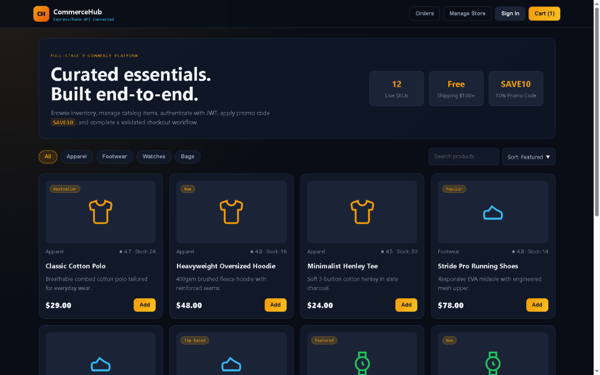

# CommerceHub — Full-Stack E-Commerce Platform

> Upgraded from the original `CodeAlpha-Ecommerence-store` project into a cohesive full-stack store and merchant catalog dashboard with salted `scrypt` authentication, HS256 JWT sessions, atomic stock-checked checkout, and a standalone browser demo fallback when deployed statically.

---

## Application Preview




## Key Improvements Over Original Codebase

| Area | Original Issue | Upgraded Solution |
| --- | --- | --- |
| **Security & Auth** | Exposed `.env` secrets, case-mismatch import (`User` vs `user`), and `/login` returned raw password hashes | Replaced with salted `crypto.scryptSync` + `timingSafeEqual`, strict `sanitizeUser()`, HS256 JWT verification, `.gitignore`, and `.env.example` |
| **API Routing** | `ProductRoutes` was never mounted; frontend hit `/api/auth/register` while backend only handled `/api/auth/signup` | Unified REST API serving both `/api/auth/signup` and `/api/auth/register`, product CRUD, order placement, and order history |
| **Checkout & Inventory** | Basic static cart with no stock validation or persistent order history | Atomic stock validation and decrement per order, `SAVE10` promo discount, free-shipping threshold (`$100+`), and authenticated `/api/orders/mine` |
| **Frontend UX** | Fragmented multi-page skeleton without real feedback states | Responsive single-page storefront with category pills, sorting, search, slide-over cart drawer, seller add-product modal, order history modal, and automatic `localStorage` fallback when API is offline |

---

## Technology Stack

- **Backend:** Node.js (`http`, `crypto`, `fs`, `path`) with zero external runtime dependencies
- **Frontend:** Semantic HTML5, modern CSS Grid/Flexbox, Vanilla ES6+
- **Persistence:** JSON datastore (`backend/data/store.json`, gitignored) + browser `localStorage` static demo mode
- **Testing:** Built-in Node.js test runner (`node --test`)

---

## Project Structure

```text
CodeAlpha-Ecommerence-store/
├── backend/
│   ├── .env.example
│   ├── package.json
│   ├── dataStore.js
│   └── server.js
├── frontend/
│   ├── index.html
│   ├── styles.css
│   └── app.js
├── tests/
│   └── commercehub.test.mjs
├── .gitignore
├── LICENSE
└── README.md
```

---

## Setup & Running Locally

### 1. Start the Full-Stack Server (API + Frontend)

```bash
cd backend
cp .env.example .env
node server.js
```

Open `http://127.0.0.1:5000` in your browser.

### 2. Run Automated Tests

```bash
node --test tests/commercehub.test.mjs
```

---

## API Endpoints

| Method | Endpoint | Auth | Description |
| --- | --- | --- | --- |
| `GET` | `/api/health` | Public | Health check |
| `POST` | `/api/auth/signup` | Public | Register a customer account (returns JWT) |
| `POST` | `/api/auth/login` | Public | Authenticate user (returns JWT) |
| `GET` | `/api/auth/me` | Bearer JWT | Fetch sanitized current user |
| `GET` | `/api/products` | Public | Filter by `category`, `q`, `sort` (`price-asc`, `price-desc`, `rating`) |
| `POST` | `/api/products` | Bearer JWT | Create a new product listing |
| `PUT` / `DELETE` | `/api/products/:id` | Bearer JWT | Update or delete a product |
| `POST` | `/api/orders` | Optional JWT | Place order, decrement stock, apply promo code `SAVE10` |
| `GET` | `/api/orders/mine` | Bearer JWT | Fetch authenticated user's order history |

---

## Limitations

- Uses a single-file JSON datastore (`backend/data/store.json`) for portability and zero-config setup rather than a multi-node database cluster.
- When deployed as a static site without the Node backend running, the frontend switches transparently to Local Demo Mode (`localStorage`) so shoppers can still browse, add to cart, manage listings, and simulate checkout.

---

## Author

**Muzammil Shabbir**  
GitHub: [@Muzammil-s](https://github.com/Muzammil-s) · Email: muzammilw10@gmail.com
